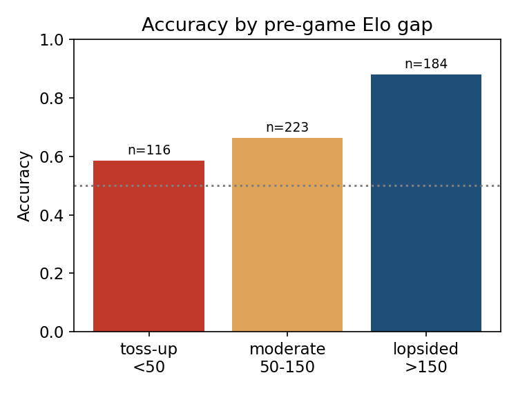
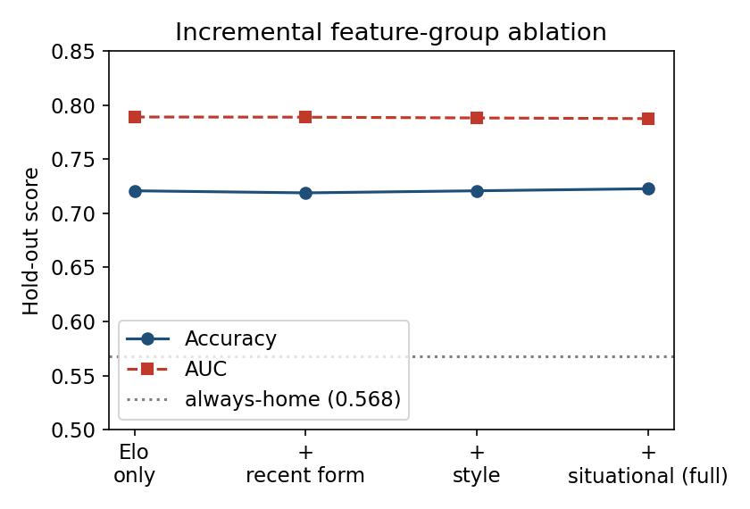
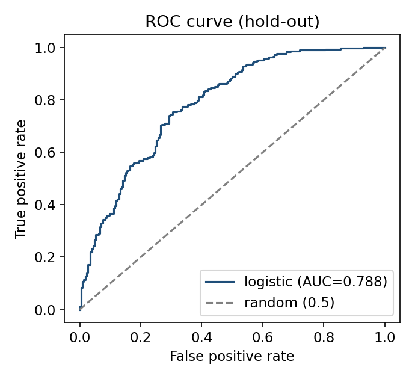
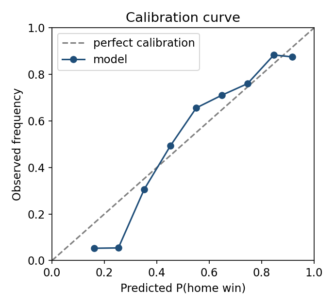
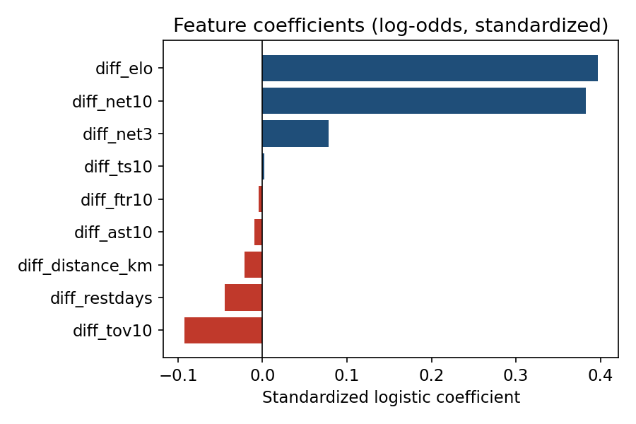
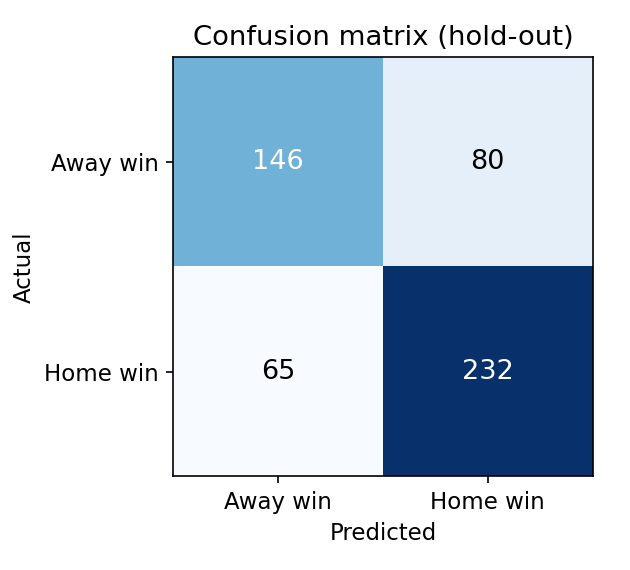
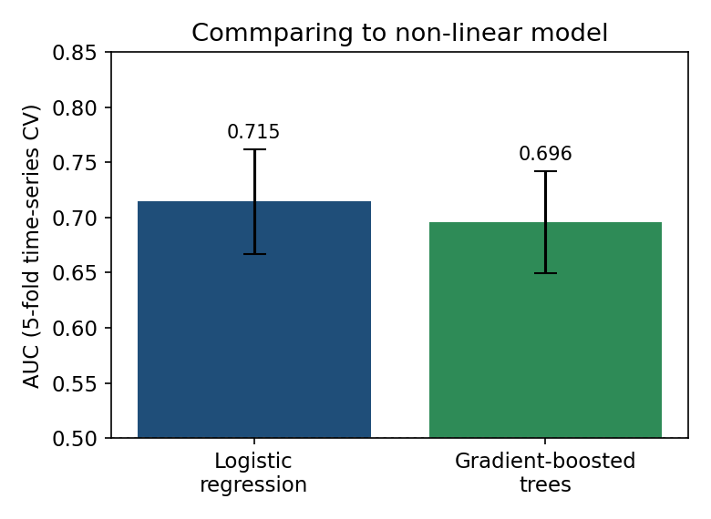

# Predicting NBA games with logistic regression

> My IB Computer Science Extended Essay: a logistic regression model that predicts whether the home team wins an NBA game, using only what was known before tip-off. It was tested on the second half of the 2025–26 season, and then frozen and used to predict the 2026 playoffs live.



**Part of [phamduylong.com](https://phamduylong.com)** · `type: school` · `status: finished` · `Extended Essay, IB Computer Science, May 2027 session`

---

## Why I built it

I play basketball and follow the NBA, and sports prediction is a clean test for a probabilistic model: every future game gives a real answer the model never saw. It also brings up the problems real machine-learning projects have, such as data leakage, corrupted data, misleading accuracy and correlated features.

I chose logistic regression because its results can be read, not just accepted. Each coefficient shows how a feature moves the log-odds of a home win, so you can see what the model is actually using. The question I most wanted to answer was whether detailed engineered features add anything beyond a single Elo rating.

**Research question:** *To what extent can a logistic regression model trained on leakage-safe rolling team statistics, Elo ratings, and schedule features predict the outcome of NBA games more effectively than naïve and Elo-only baselines?*

## Before → after

| Before | After |
| --- | --- |
| Always pick the home team: **56.8%** right on the test games | The full model: **72.3%** right on 523 unseen games (95% CI 68.5–75.9%) |

## Results

| Test | Games | Accuracy | Other |
| --- | --- | --- | --- |
| Hold-out (last 20% of games, Feb–Jun 2026) | 523 | **72.3%** | AUC 0.788 · Brier skill score 0.24 |
| Baseline: always pick the home team | 523 | 56.8% | |
| Baseline: Elo rating only | 523 | 72.1% | |
| Live: 2026 playoffs, model frozen on 18 Apr 2026 | 83 | **65.1%** | Always-home 55.4% · Brier skill score +0.12 · log-loss 0.624 |
| Time-series cross-validation, 5 folds | — | 65.6% ± 4.5 | AUC 0.715 ± 0.047 |

What the numbers say:

- **Elo does almost all the work.** Adding eight more features on top of Elo moved accuracy from 72.1% to 72.3%. A McNemar test finds no real difference (p = 1.0). The lasso confirms this: only Elo and 10-game net rating carry large weights, and two features are dropped to zero.
- **Playoffs are harder.** In the hold-out set the model was right on 74.2% of regular-season games but 68.1% of playoff games (Fisher p = 0.17, so a direction rather than proof). In the live playoff test it was right 65.1% of the time, and its Brier skill score fell by about half, though it still beat always-home.
- **It knows when it's guessing.** When the model is more than 70% confident it's right 85.6% of the time. On toss-ups, where the Elo gap is under 50, it's barely better than a coin (58.6%).
- **A more complex model didn't help.** Gradient-boosted trees scored lower than logistic regression on both the hold-out split and cross-validation.

## Features

Every feature is a **home-minus-away difference**, computed only from games played *before* the one being predicted.

| Feature | Meaning |
| --- | --- |
| `diff_elo` | Elo rating before the game (start 1500, K = 20, +100 home-court in the expectation) |
| `diff_net10` | Net rating (points scored minus allowed per 100 possessions), average of the last 10 games |
| `diff_net3` | Net rating, last 3 games |
| `diff_ts10` | True shooting %, last 10 games |
| `diff_tov10` | Turnover %, last 10 games |
| `diff_ftr10` | Free-throw rate, last 10 games |
| `diff_ast10` | Assists, last 10 games |
| `diff_restdays` | Days of rest since the previous game |
| `diff_distance_km` | Distance travelled from the previous game's arena (haversine) |

## How it works

1. **`building.py`** turns raw team box scores into one row per game.
   - It reads home/away and the opponent from the match-up text.
   - It computes possessions and the efficiency stats.
   - It builds the rolling averages with a one-game shift, so a game never sees its own result.
   - It runs Elo through the season in date order and works out rest days and travel.
   - It then trains the model on the first 80% of games in time order and tests on the last 20%. There's no shuffling, so the model never learns from the future.
2. **`evaluation.py`** re-fits the model and runs the checks behind the Results section:
   - confusion matrix and baselines
   - Brier and log-loss, McNemar and bootstrap tests, and multicollinearity (VIF)
   - feature-group ablation and error analysis by Elo gap and by confidence
   - regular season vs playoffs, time-series cross-validation, lasso, and a gradient-boosted comparison
   - all seven figures
3. **`experiment.py`** is the live playoff test. The model was trained only on games before 18 April 2026 and then frozen. Each of the 83 playoff games through 13 June was predicted and logged before it was played, and the result was added afterwards. The model was never retrained during the run. `experiment_predictions.csv` is that log, and the script re-checks it against the final game table.

## Built with

`Python` · `pandas` · `NumPy` · `scikit-learn` · `SciPy` · `Matplotlib`

## Run it

```bash
git clone https://github.com/pdlong-09/NBA_logistic_regression_EE.git
cd NBA_logistic_regression_EE
pip install -r requirements.txt
python evaluation.py     # rebuilds evaluation_report.csv and all figures
python experiment.py     # re-runs the 2026 playoff test
```

`evaluation.py` and `experiment.py` run from the included `nba_game_table.csv`. `building.py` needs the raw files `team_box.csv` and `team_arena.csv`, which aren't in this repo. The box scores come from the [NBA.com Stats team box scores](https://www.nba.com/stats/teams/boxscores) portal, and the arena coordinates were collected from Google Maps.

## Files

| File | What it is |
| --- | --- |
| `building.py` | Feature engineering, Elo, game table, first model |
| `evaluation.py` | Full evaluation and figures |
| `experiment.py` | 2026 playoff test |
| `nba_game_table.csv` | 2,615 games, 24 Oct 2024 – 13 Jun 2026, with all features |
| `experiment_predictions.csv` | Model predictions for the 83 playoff games |
| `nba_model_metrics.csv`, `nba_model_coefficients.csv` | Hold-out metrics and coefficients |
| `evaluation_report.csv` | Full text report from `evaluation.py` |
| `experiment_metrics.csv` | Playoff test metrics |
| `fig_*.png` | Confusion matrix, ROC, calibration, coefficients, ablation, error by Elo gap, model comparison |

## What I learned

Most of the work was getting the data honest before the model meant anything:

- **Matchups from row position.** My first version paired home and away rows by where they sat in the file. That created games between teams that never played each other. I replaced it with a `GAME_ID` built from the date and both team names, plus a check that every game has both teams exactly once.
- **A date-format bug.** Three teams appeared to play twice on one day. The cause was pandas reading some DD/MM/YY dates as MM/DD/YY. About 13% of dates were wrong, which silently broke every rolling average and Elo update until I set the format explicitly.
- **Leakage.** A rolling average without `.shift(1)` quietly includes the game being predicted, so the leakage protection has to be part of how every feature is defined.

The biggest lesson was about baselines. The 72.3% looks good until you compare it with Elo alone. A fair baseline told me more than the accuracy did.

## Limitations

- **Only about two seasons of data** (2,615 games), and only at team level. There's nothing on injuries, rotations or who actually played, which matters most in the playoffs.
- **Elo starts every team at 1,500 in October 2024**, so early-season ratings carry little information.
- **The hold-out window mixes regular-season and playoff games.** It starts on 7 February 2026, so it leans toward the late season. That's why the playoffs also get their own separate test.
- **Settings follow convention rather than tuning:** the 10- and 3-game windows, K = 20 and the +100 home advantage. The ablation suggests changing them would matter little.
- **Calibration is weaker at the low end.** Where the model gives the home team around 15–25%, home teams actually win less often than it predicts.
- **The raw box-score files aren't included**, so `building.py` can't be re-run from this repo alone.

## Figures

<p>
  
  
  
  
  
  
</p>

---

<sub>Phạm Duy Long · Hà Nội · [phamduylong.com](https://phamduylong.com)</sub>
